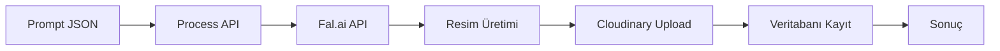

# 🎨 Fal.ai Resim Üretim Sistemi

## 📋 Genel Bakış

Bu sistem, Fal.ai API'sini kullanarak AI tabanlı resim üretimi yapar ve üretilen resimleri otomatik olarak Cloudinary'ye yükler.

## 🚀 Özellikler

- **Fal.ai Entegrasyonu**: Birden fazla AI modeli desteği
- **Cloudinary Otomatik Upload**: Üretilen resimler otomatik olarak buluta yüklenir
- **Veritabanı Kayıt**: Tüm üretimler PostgreSQL'de saklanır
- **Test Sistemi**: JSON tabanlı kolay test ve üretim
- **Inngest Desteği**: Asenkron iş akışı yönetimi (opsiyonel)

## 🛠️ Kurulum

### 1. Environment Variables

`.env.local` dosyasına ekleyin:

```env
FAL_AI_KEY="your-fal-ai-key"
CLOUDINARY_CLOUD_NAME="your-cloud-name"
CLOUDINARY_API_KEY="your-api-key"
CLOUDINARY_API_SECRET="your-api-secret"
```

### 2. Veritabanı Tablosu

Tabloyu oluşturmak için:

```bash
curl http://localhost:3001/api/setup-image-table
```

## 📁 Dosya Yapısı

```
├── test-prompts.json                    # Test promptları
├── test-image-generation.sh             # Test script
├── app/api/
│   ├── generate-fal-image/             # Inngest ile üretim
│   ├── process-prompts/                # Direkt API çağrısı
│   └── check-generated-images/         # Sonuçları kontrol
└── lib/inngest/
    └── fal-ai-generation.ts            # Inngest fonksiyonları
```

## 🎮 Kullanım

### Yöntem 1: Test JSON ile Üretim (Önerilen)

#### 1. JSON Dosyasını Düzenleyin

`test-prompts.json`:

```json
{
  "prompts": [
    {
      "id": 1,
      "prompt": "Modern ısı pompası sistemi, lüks villa",
      "model": "fal-ai/flux/schnell",
      "generate": true    // ← true yapın üretim için
    },
    {
      "id": 2,
      "prompt": "Güneş panelleri, çatı montajı",
      "model": "fal-ai/flux/schnell",
      "generate": false   // ← false ise atlanır
    }
  ],
  "settings": {
    "autoGenerate": true,
    "uploadToCloudinary": true,
    "imageSize": "landscape_16_9",
    "numImages": 1
  }
}
```

#### 2. Test Script'ini Çalıştırın

```bash
./test-image-generation.sh
```

Veya doğrudan API:

```bash
curl -X POST http://localhost:3001/api/process-prompts
```

### Yöntem 2: API ile Direkt Üretim

```bash
curl -X POST http://localhost:3001/api/generate-fal-image \
  -H "Content-Type: application/json" \
  -d '{
    "prompt": "Lüks villa ısı pompası sistemi",
    "model": "flux-schnell",
    "imageSize": "landscape_16_9"
  }'
```

## 🤖 Desteklenen Modeller

| Model Kodu | Açıklama | Hız | Kalite | Maliyet |
|------------|----------|-----|--------|---------|
| `fal-ai/flux/schnell` | Flux Schnell (Varsayılan) | ⚡⚡⚡ | ★★★ | $ |
| `fal-ai/flux/dev` | Flux Development | ⚡⚡ | ★★★★ | $$ |
| `fal-ai/flux-pro` | Flux Professional | ⚡ | ★★★★★ | $$$ |
| `fal-ai/fast-sdxl` | Stable Diffusion XL | ⚡⚡⚡ | ★★★ | $ |
| `fal-ai/stable-diffusion-v3-medium` | SD 3.0 | ⚡⚡ | ★★★★ | $$ |

## 📊 Sonuçları Kontrol

### Veritabanındaki Resimleri Görüntüle

```bash
curl http://localhost:3001/api/check-generated-images
```

### Event Logları Kontrol

```bash
curl http://localhost:3001/api/check-events
```

## 🔄 İş Akışı



## 📝 Örnek Çıktı

```json
{
  "success": true,
  "processed": 1,
  "results": [
    {
      "promptId": 1,
      "success": true,
      "images": 1,
      "cloudinaryUrls": [
        "https://res.cloudinary.com/dgfdk0l8j/image/upload/v1757610366/test-generated/test-1757610363995.jpg"
      ]
    }
  ]
}
```

## 🗄️ Veritabanı Şeması

```sql
CREATE TABLE generated_images (
    id SERIAL PRIMARY KEY,
    original_prompt TEXT NOT NULL,
    enhanced_prompt TEXT,
    brand_id TEXT,
    size VARCHAR(20),
    style VARCHAR(50),
    status VARCHAR(20),
    cloudinary_url TEXT,
    cloudinary_public_id TEXT,
    metadata JSONB,
    created_at TIMESTAMP,
    updated_at TIMESTAMP
);
```

## 🐛 Sorun Giderme

### Inngest Çalışmıyor

Inngest dev server'ı başlatın:

```bash
npx inngest-cli dev
```

### Fal.ai 404 Hatası

Model adının doğru olduğundan emin olun. Desteklenen modeller listesine bakın.

### Cloudinary Upload Hatası

Environment variables'ların doğru olduğundan emin olun:

```bash
echo $CLOUDINARY_CLOUD_NAME
echo $CLOUDINARY_API_KEY
```

## 🔒 Güvenlik Notları

- API anahtarlarını **asla** commit etmeyin
- `.env.local` dosyasının `.gitignore`'da olduğundan emin olun
- Production'da rate limiting kullanın
- NSFW içerik kontrolü aktif tutun

## 📈 Performans İpuçları

1. **Batch Processing**: Birden fazla prompt'u aynı anda işleyin
2. **Model Seçimi**: Hız için `schnell`, kalite için `dev/pro` kullanın
3. **Caching**: Aynı prompt'lar için cache kullanın
4. **Webhook**: Inngest webhook'ları ile asenkron işlem

## 🚦 Durum Kodları

- `pending`: İşlem başlamadı
- `processing`: Üretim devam ediyor
- `completed`: Başarıyla tamamlandı
- `failed`: Hata oluştu
- `partial`: Kısmen başarılı (Cloudinary hatası vb.)

## 📞 Destek

Sorunlar için:
1. Console loglarını kontrol edin
2. Event logs tablosunu inceleyin
3. Fal.ai dashboard'u kontrol edin
4. API rate limitleri kontrol edin

## 🎯 Kullanım Senaryoları

1. **Ürün Görselleri**: Ürün tanıtımları için AI görseller
2. **Blog Görselleri**: Blog yazıları için otomatik görsel üretimi
3. **Sosyal Medya**: Instagram/Facebook için içerik üretimi
4. **Mockup'lar**: Hızlı prototip görseller
5. **A/B Testing**: Farklı görsel varyasyonları test etme

---

📌 **Not**: Bu sistem aktif geliştirme aşamasındadır. Üretim ortamında kullanmadan önce kapsamlı test yapın.