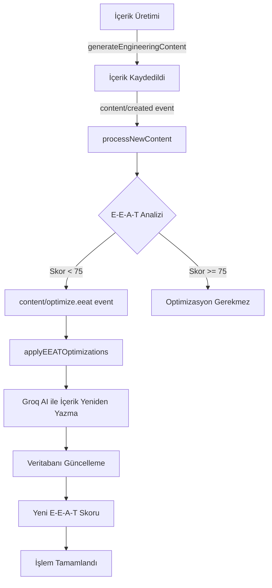

# Inngest İşlem Süreçleri Raporu

## Genel Bakış
Bu rapor, Gül-Tekin Mühendislik web uygulamasında kullanılan Inngest fonksiyonlarının detaylı dokümantasyonunu içerir. Sistem, içerik üretimi, SEO optimizasyonu ve E-E-A-T (Experience, Expertise, Authoritativeness, Trustworthiness) analizleri için otomatik işlem süreçleri kullanmaktadır.

---

## 📋 İçindekiler
1. [Test ve Kullanıcı Fonksiyonları](#test-ve-kullanıcı-fonksiyonları)
2. [Veri Senkronizasyon Fonksiyonları](#veri-senkronizasyon-fonksiyonları)
3. [İçerik Üretim ve Optimizasyon Fonksiyonları](#i̇çerik-üretim-ve-optimizasyon-fonksiyonları)
4. [E-E-A-T Optimizasyon Süreci](#e-e-a-t-optimizasyon-süreci)
5. [İşlem Akışı Diyagramı](#i̇şlem-akışı-diyagramı)

---

## Test ve Kullanıcı Fonksiyonları

### 1. helloWorld
- **ID:** `hello-world`
- **Tetikleme:** Event - `test/hello.world`
- **Amaç:** Test fonksiyonu
- **İşlem:** 1 saniye bekler ve hoş geldin mesajı döndürür

### 2. sendWelcomeEmail
- **ID:** `send-welcome-email`
- **Tetikleme:** Event - `user/signup`
- **Amaç:** Yeni kullanıcı kayıtlarında hoş geldin e-postası gönderimi
- **İşlem Adımları:**
  1. Yeni kullanıcıyı loglar
  2. 2 saniye bekler
  3. Hoş geldin e-postası gönderir
  4. İşlem sonucunu döndürür

---

## Veri Senkronizasyon Fonksiyonları

### 3. processDataSync
- **ID:** `process-data-sync`
- **Tetikleme:** Cron - `0 */6 * * *` (Her 6 saatte bir)
- **Amaç:** Periyodik veri senkronizasyonu
- **İşlem Adımları:**
  1. Veri çeker (simüle edilmiş)
  2. Veriyi işler
  3. Sonuçları döndürür

### 4. logEventToDatabase
- **ID:** `log-event-to-database`
- **Tetikleme:** Event - `app/event.log`
- **Deneme Sayısı:** 3
- **Amaç:** Sistem olaylarını Neon veritabanına kaydetme
- **İşlem Adımları:**
  1. Event log kaydı oluşturur (status: 'processing')
  2. 2 saniye işlem simülasyonu
  3. Event'i işler
  4. Log durumunu günceller (status: 'completed' veya 'failed')
  5. Opsiyonel bildirim gönderimi

### 5. searchAndSaveResults
- **ID:** `search-and-save-results`
- **Tetikleme:** Cron - `0 */6 * * *` (Her 6 saatte bir)
- **Deneme Sayısı:** 2
- **Amaç:** Exa API ile mühendislik konularında arama ve kaydetme
- **Konular:**
  - Isı Pompası Sistemleri
  - Güneş Enerjisi Sistemleri
  - Su Depoları ve Hidrofor Sistemleri
  - Yerden Isıtma Sistemleri
  - Su Arıtma Sistemleri
  - Klima Sistemleri
  - Sulama Sistemleri
  - Termosifonik Sistemler
- **İşlem Adımları:**
  1. Saate göre döngüsel konu seçimi
  2. Exa API ile son 30 günün içeriğini arama
  3. Sonuçları `search_results` tablosuna kaydetme
  4. Duplicate URL kontrolü
  5. 7 günden eski kayıtları temizleme
  6. İşlemi `event_logs` tablosuna kaydetme

---

## İçerik Üretim ve Optimizasyon Fonksiyonları

### 6. generateEngineeringContent
- **ID:** `generate-engineering-content`
- **Tetikleme:** Cron - `0 */6 * * *` (Her 6 saatte bir)
- **Deneme Sayısı:** 2
- **Amaç:** Groq ve Exa API'leri ile mühendislik içeriği üretimi
- **İşlem Adımları:**
  1. Saate göre konu seçimi (8 konudan biri)
  2. Bugün için aynı konuda içerik kontrolü
  3. Exa API ile konu araştırması
  4. Groq AI (Llama 3.3 70B) ile içerik üretimi:
     - 750+ kelime SEO-dostu blog yazısı
     - Dinamik SEO başlıkları
     - Meta açıklama ve anahtar kelimeler
     - Benzersiz URL slug (tarih ekli)
  5. İçeriği `generated_content` tablosuna kaydetme
  6. `content/created` event'ini tetikleme
  7. İşlemi loglama

### 7. processNewContent
- **ID:** `process-new-content`
- **Tetikleme:** Event - `content/created`
- **Deneme Sayısı:** 2
- **Amaç:** Yeni içerik oluşturulduktan sonra SEO ve E-E-A-T optimizasyonları
- **İşlem Adımları:**
  1. İçerik detaylarını veritabanından çekme
  2. Sitemap güncelleme için metadata oluşturma
  3. Social media meta tagları (Open Graph) ekleme
  4. **E-E-A-T Analizi (Groq AI ile):**
     - Experience (Deneyim): 0-25 puan
     - Expertise (Uzmanlık): 0-25 puan
     - Authoritativeness (Otorite): 0-25 puan
     - Trustworthiness (Güvenilirlik): 0-25 puan
     - YMYL kategori tespiti
  5. Schema.org markup üretimi:
     - Article Schema
     - LocalBusiness Schema
     - ProfessionalService Schema
  6. SEO skoru hesaplama (E-E-A-T %50 ağırlıklı)
  7. İçerik dağıtım planlaması (newsletter, sosyal medya)
  8. İlgili içerik ilişkilendirme
  9. **E-E-A-T skoru <75 ise `content/optimize.eeat` event'ini tetikleme**
  10. İşlem tamamlama logu

### 8. applyEEATOptimizations
- **ID:** `apply-eeat-optimizations`
- **Tetikleme:** Event - `content/optimize.eeat`
- **Deneme Sayısı:** 2
- **Amaç:** E-E-A-T skorunu artırmak için içeriği otomatik optimize etme
- **İşlem Adımları:**
  1. Mevcut içeriği veritabanından çekme
  2. Optimizasyon gerekliliği kontrolü:
     - Daha önce optimize edilmiş mi?
     - E-E-A-T skoru <75 mi?
     - Force flag aktif mi?
  3. **Groq AI ile içerik optimizasyonu (Mixtral-8x7b):**
     - **Deneyim Eklemeleri:**
       - Bodrum'da gerçek proje örnekleri
       - 20 yıllık deneyim vurgusu
       - Müşteri başarı hikayeleri
     - **Uzmanlık Eklemeleri:**
       - Detaylı teknik bilgiler
       - ISO 9001, CE, TSE sertifikaları
       - Karşılaştırmalı analizler
     - **Otorite Eklemeleri:**
       - "Bodrum'un lider mühendislik firması" vurgusu
       - 500+ proje referansı
       - Çalışılan markalar (Aldea, Varmeks, LG vb.)
     - **Güvenilirlik Eklemeleri:**
       - İletişim bilgileri
       - 7/24 teknik destek
       - Garanti ve servis vurgusu
  4. **Veritabanı güncelleme:**
     - `content` kolonunu yeni içerikle değiştirme
     - Orijinal içeriğin ilk 1000 karakterini `metadata.originalContent`'e kaydetme
     - `metadata.eeatOptimized`: true
     - `metadata.eeatOptimizationDate`: tarih
  5. Optimizasyon sonrası E-E-A-T skorunu yeniden analiz
  6. Yeni analizi `metadata.eeatAnalysisPostOptimization`'a kaydetme
  7. İşlem logu oluşturma (orijinal skor, yeni skor, iyileşme miktarı)

---

## E-E-A-T Optimizasyon Süreci

### Otomatik Optimizasyon Akışı



### E-E-A-T Skorlama Kriterleri

#### Experience (Deneyim) - 25 Puan
- Gerçek proje örnekleri
- Pratik uygulama detayları
- Yerel (Bodrum) deneyimler
- Müşteri hikayeleri

#### Expertise (Uzmanlık) - 25 Puan
- Teknik doğruluk
- Profesyonel terminoloji
- Detaylı açıklamalar
- Sektörel bilgi derinliği

#### Authoritativeness (Otorite) - 25 Puan
- Firma referansları
- Sektördeki konum
- Marka güvenilirliği
- Sertifikalar ve belgeler

#### Trustworthiness (Güvenilirlik) - 25 Puan
- İletişim bilgileri
- Şeffaflık
- Müşteri odaklılık
- Garanti ve servis bilgileri

---

## İşlem Akışı Diyagramı

### Ana İçerik Üretim ve Optimizasyon Döngüsü

```
Her 6 Saatte Bir (Cron)
    ↓
1. searchAndSaveResults
   - Exa API ile arama
   - Sonuçları kaydet
   - Eski kayıtları temizle
    ↓
2. generateEngineeringContent
   - Konu seç
   - İçerik üret (Groq AI)
   - Veritabanına kaydet
    ↓
3. content/created event
    ↓
4. processNewContent
   - SEO analizi
   - E-E-A-T analizi
   - Schema markup
   - Sitemap güncelleme
    ↓
5. E-E-A-T Skoru < 75?
    ↓ (Evet)
6. content/optimize.eeat event
    ↓
7. applyEEATOptimizations
   - İçeriği optimize et
   - Veritabanını güncelle
   - Skoru yeniden hesapla
    ↓
8. İşlem Tamamlandı
```

---

## Veritabanı Tabloları

### generated_content
- **id**: Benzersiz kimlik
- **topic**: İçerik konusu
- **title**: İçerik başlığı
- **content**: Ana içerik (E-E-A-T optimizasyonu ile güncellenir)
- **slug**: URL-dostu başlık
- **meta_title**: SEO meta başlığı
- **meta_description**: SEO meta açıklaması
- **keywords**: Anahtar kelimeler (array)
- **search_data**: Araştırma verileri (JSONB)
- **metadata**: Tüm analizler ve optimizasyonlar (JSONB)
  - `eeatAnalysis`: İlk E-E-A-T analizi
  - `eeatOptimized`: Optimizasyon durumu
  - `eeatOptimizationDate`: Optimizasyon tarihi
  - `eeatAnalysisPostOptimization`: Optimizasyon sonrası analiz
  - `originalContent`: Orijinal içeriğin yedeği
  - `schemaMarkup`: Schema.org işaretlemeleri
  - `socialMeta`: Sosyal medya meta tagları
  - `seoAnalysis`: SEO analizi
  - `relatedContent`: İlgili içerikler
- **status**: Yayın durumu
- **published_at**: Yayın tarihi
- **created_at**: Oluşturma tarihi
- **updated_at**: Güncelleme tarihi

### search_results
- **id**: Benzersiz kimlik
- **search_query**: Arama sorgusu
- **search_type**: Arama tipi
- **result_title**: Sonuç başlığı
- **result_url**: Sonuç URL'i (unique)
- **result_content**: İçerik
- **result_score**: Alakalılık skoru
- **result_published_date**: Yayın tarihi
- **result_author**: Yazar
- **highlights**: Öne çıkan kısımlar
- **metadata**: Ek veriler
- **created_at**: Kayıt tarihi

### event_logs
- **id**: Benzersiz kimlik
- **event_name**: Olay adı
- **event_type**: Olay tipi
- **status**: Durum (pending, processing, completed, failed)
- **payload**: Olay verileri (JSONB)
- **metadata**: Ek veriler (JSONB)
- **error_message**: Hata mesajı (varsa)
- **processed_at**: İşlenme zamanı
- **created_at**: Oluşturma zamanı
- **updated_at**: Güncelleme zamanı

---

## Performans Metrikleri

### İçerik Üretim
- **Frekans**: Günde 4 kez (her 6 saatte)
- **Konu Döngüsü**: 8 farklı mühendislik konusu
- **Ortalama İçerik Uzunluğu**: 750+ kelime
- **E-E-A-T Hedef Skoru**: 75/100

### API Limitleri
- **Exa API**: 5 sonuç/arama, son 30 gün
- **Groq AI**: 
  - İçerik üretimi: max 2500 token
  - E-E-A-T analizi: max 2000 token
  - Optimizasyon: max 3500 token

### Veri Saklama
- **Arama Sonuçları**: 7 gün
- **İçerik**: Süresiz
- **Event Logları**: Süresiz
- **Orijinal İçerik Yedeği**: İlk 1000 karakter

---

## Güvenlik ve Hata Yönetimi

### Güvenlik Önlemleri
- Rakip firma isimlerinin filtrelenmesi
- Dış linklerin kaldırılması
- Sadece Gül-Tekin Mühendislik referansları
- API anahtarlarının çevre değişkenlerinde saklanması

### Hata Yönetimi
- Her fonksiyon için retry mekanizması (2-3 deneme)
- Hata durumlarında fallback değerler
- Detaylı error logging
- İşlem durumu takibi (event_logs)

---

## İyileştirme Önerileri

1. **Cache Mekanizması**: Sık erişilen içerikler için önbellekleme
2. **A/B Testing**: Farklı E-E-A-T optimizasyon stratejilerini test etme
3. **Metrik Takibi**: Google Analytics entegrasyonu ile performans ölçümü
4. **Manual Review**: Yüksek skorlu içerikler için manuel inceleme süreci
5. **Multilingual Support**: İngilizce içerik üretimi ekleme
6. **Image Optimization**: İçeriklere görsel ekleme ve optimizasyon
7. **Newsletter Integration**: Otomatik e-posta bülteni gönderimi
8. **Social Media Automation**: Sosyal medya paylaşım otomasyonu

---

## Sonuç

Inngest tabanlı bu otomasyon sistemi, Gül-Tekin Mühendislik için:
- **Otomatik İçerik Üretimi**: Günde 4 farklı mühendislik konusunda içerik
- **SEO Optimizasyonu**: Google'ın E-E-A-T kriterlerine uygun içerik
- **Veri Güncelleme**: Otomatik içerik iyileştirme ve veritabanı güncelleme
- **Performans Takibi**: Detaylı loglama ve metrik takibi

sağlayarak, web sitesinin organik trafiğini ve arama motoru sıralamasını artırmayı hedeflemektedir.

---

*Rapor Tarihi: ${new Date().toLocaleDateString('tr-TR')}*
*Versiyon: 1.0*