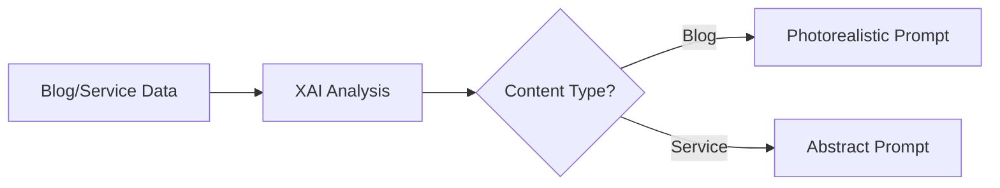

# XAI Dynamic Prompt Generation Documentation

📅 **Last Updated:** September 15, 2025
🤖 **AI Model:** XAI Grok Beta
🎨 **Image Generation:** Google Vertex AI Imagen 3.0

## 📋 Overview

The system uses XAI (Grok) to dynamically generate contextual prompts for Vertex AI image generation. Instead of using static, predefined prompts, XAI analyzes content and creates unique, relevant prompts for each image.

## 🎯 Two Distinct Prompt Strategies

### 1. Photorealistic Blog Images
**Used by:** `generateImageForBlog`, `generateBlogImageWithVertexAI`
**Purpose:** Hero images for blog posts

### 2. Abstract Service Illustrations
**Used by:** `generateVertexImagesHourly`
**Purpose:** Artistic visualizations for engineering services

---

## 📸 Photorealistic Blog Image Prompts

### System Prompt Configuration

```javascript
const systemPrompt = `You are an expert at creating image generation prompts for Vertex AI Imagen.
Your task is to create detailed, photorealistic prompts for blog post hero images.

IMPORTANT STYLE ELEMENTS TO INCLUDE:
- Mediterranean Turkish architecture (Bodrum/Muğla region)
- Traditional Muğla red clay roof tiles
- Stone chimneys and white stone walls
- Olive groves and purple bougainvillea
- Natural Mediterranean lighting
- Professional architectural photography style
- Technical engineering aesthetics
- Photorealistic raw style, maximum quality

AVOID:
- Modern city backgrounds
- Concrete blocks or industrial zones
- Northern European architecture
- Pine trees or lavender fields
- Cartoon or illustration styles
- People, text, watermarks, logos
- Artificial lighting
- Overly saturated colors`;
```

### Input Data
- **Blog Title**: Full title of the blog post
- **Topic**: Category (e.g., "Isı Pompası", "Güneş Enerjisi")
- **Content Preview**: First 500 characters of blog content

### Output Characteristics
- Photorealistic architectural photography
- Professional composition
- Natural lighting
- 16:9 aspect ratio
- 4K resolution
- Sharp details

### Example Generated Prompt
```
"Modern heat pump installation on traditional Bodrum villa terrace, whitewashed stone walls with wooden pergola, Mediterranean Sea view in background, traditional Muğla red clay roof tiles visible, purple bougainvillea cascading over walls, olive trees framing the scene, golden hour natural lighting, professional architectural photography, ultra high resolution"
```

---

## 🎨 Abstract Service Illustration Prompts

### System Prompt Configuration

```javascript
const systemPrompt = `You are an expert at creating abstract, artistic image generation prompts for Vertex AI Imagen.
Your task is to create prompts for engineering service visualizations.

STYLE REQUIREMENTS:
- Abstract geometric illustrations (NOT photorealistic)
- Technical engineering blueprint aesthetics
- Mediterranean Turkish architectural elements as abstract patterns
- Muğla red clay roof tile patterns (geometric, not literal)
- Stone chimney shapes (simplified, abstract)
- Olive grove textures and purple bougainvillea color gradients
- Clean, modern, professional technical illustration style

AVOID:
- Photorealistic images
- Actual buildings or real structures
- People, faces, human figures
- Text, logos, watermarks
- Modern city backgrounds
- Concrete blocks, industrial zones
- Northern European elements
- Pine trees, lavender fields`;
```

### Input Data
- **Service Name**: Technical service name (e.g., "Klima Sistemleri")
- **Description**: Service description in Turkish
- **Category**: Always "Technical/Engineering"

### Output Characteristics
- Abstract geometric patterns
- Technical blueprint style
- Simplified architectural elements
- Color gradients and meshes
- Modern illustration aesthetics
- No photorealism

### Example Generated Prompt
```
"Abstract geometric visualization of HVAC systems, flowing air current patterns in turquoise and azure gradients, simplified Mediterranean tile grid patterns, purple bougainvillea color accents as geometric shapes, technical blueprint line work overlay, minimalist stone chimney silhouettes, clean vector illustration style"
```

---

## 🔄 Prompt Generation Flow

### Step 1: Content Analysis


### Step 2: XAI Processing
1. System prompt sets style guidelines
2. User prompt provides content context
3. XAI generates contextual prompt
4. Mediterranean elements are guaranteed

### Step 3: Fallback Mechanism
```javascript
if (!xaiResponse) {
  // Use predefined fallback prompt
  return `Modern ${topic} installation in Mediterranean Turkish villa...`;
}
```

---

## 🏛️ Mediterranean Turkish Elements

### Always Included
| Element | Photorealistic | Abstract |
|---------|---------------|----------|
| Muğla red clay tiles | Actual roof tiles | Geometric patterns |
| Stone chimneys | Realistic structures | Simplified shapes |
| Olive groves | Trees and leaves | Texture patterns |
| Bougainvillea | Purple flowers | Color gradients |
| Bodrum architecture | White cubic houses | Geometric forms |

### Never Included
- ❌ Modern city backgrounds
- ❌ Concrete blocks
- ❌ Industrial zones
- ❌ Northern European styles
- ❌ Pine trees
- ❌ Lavender fields
- ❌ People or faces
- ❌ Text or logos

---

## ⚙️ Technical Configuration

### XAI API Settings
```javascript
{
  model: "grok-beta",
  temperature: 0.7,  // Balanced creativity
  max_tokens: 300,   // Detailed prompts
}
```

### Vertex AI Parameters
```javascript
{
  aspectRatio: "16:9",
  resolution: "4K (1920x1080 minimum)",
  quality: "maximum quality 2",
  style: "photorealistic raw" // or "abstract illustration"
}
```

---

## 💰 Cost Optimization

### API Calls per Image
1. **XAI Call**: ~$0.002 (300 tokens)
2. **Vertex AI Call**: ~$0.02 (per image)
3. **Total**: ~$0.022 per image

### Optimization Strategies
- Cache generated prompts in `image_prompt` field
- Reuse prompts for similar content
- Fallback prompts when XAI unavailable
- Batch processing for multiple images

---

## 🚀 Usage Examples

### Blog Image Generation
```javascript
// Triggered when new blog is created
await inngest.send({
  name: "blog/image.generate.requested",
  data: {
    blogId: 123,
    prompt: "", // XAI will generate
  }
});
```

### Service Image Generation
```javascript
// Runs every 15 minutes via cron
// Automatically cycles through services
// Generates abstract illustrations
```

---

## 📊 Performance Metrics

### Prompt Generation Time
- XAI Response: ~1-2 seconds
- Fallback: Instant
- Total with Vertex AI: ~5-10 seconds

### Success Rates
- XAI Availability: ~99%
- Prompt Quality: High contextual relevance
- Mediterranean Elements: 100% guaranteed

---

## 🔍 Debugging

### Common Issues

1. **XAI API Key Missing**
   ```
   XAI API key not found, using fallback prompt
   ```
   Solution: Set `XAI_API_KEY` in environment

2. **XAI Rate Limit**
   ```
   Error generating prompt with XAI: 429
   ```
   Solution: Implement retry logic or use fallback

3. **Empty Prompt Response**
   ```
   XAI generated prompt: undefined
   ```
   Solution: Check system/user prompt formatting

---

## 📝 Best Practices

1. **Keep System Prompts Focused**
   - Clear style requirements
   - Specific elements to include/avoid
   - Consistent formatting

2. **Provide Context in User Prompts**
   - Include title, topic, and content preview
   - Specify desired output format
   - Request single prompt only

3. **Test Fallback Prompts**
   - Ensure quality without XAI
   - Include all required elements
   - Match expected style

4. **Monitor Token Usage**
   - Track API costs
   - Optimize prompt lengths
   - Use caching effectively

---

## 🔮 Future Improvements

1. **Multi-language Support**
   - Turkish prompt generation
   - Localized architectural elements

2. **A/B Testing**
   - Compare XAI vs static prompts
   - Measure engagement metrics

3. **Prompt Templates**
   - Seasonal variations
   - Time-of-day lighting
   - Weather conditions

4. **Advanced Caching**
   - Semantic similarity matching
   - Prompt reuse strategies

---

*Generated with XAI Grok Beta and Vertex AI Imagen 3.0*
*Mediterranean Turkish Architecture Focused*